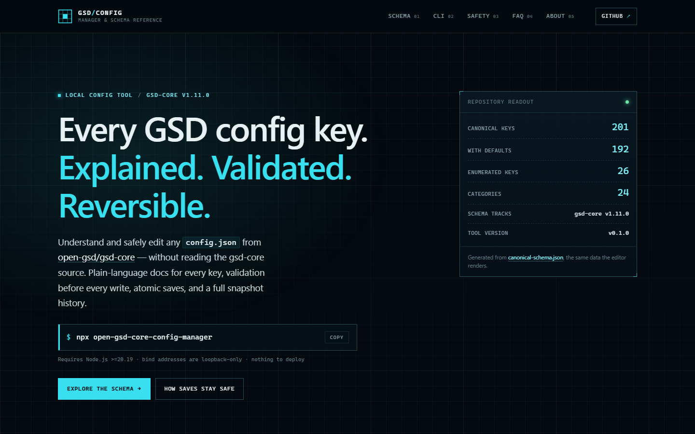
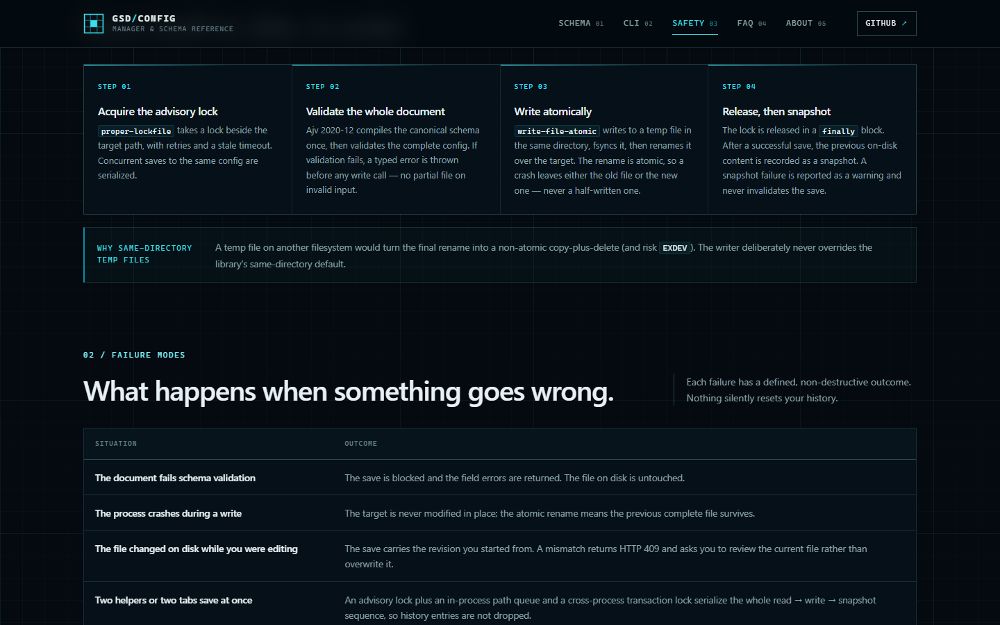
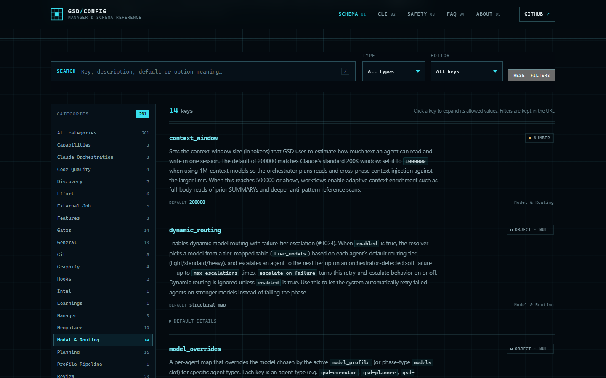

# GSD Config Manager

**Understand and safely edit any [GSD (`open-gsd/gsd-core`)](https://github.com/open-gsd/gsd-core) `config.json` — without reading the gsd-core source.**

A local, private, browser-based editor for every GSD config across all of your projects. Every key is documented in plain language, every save is validated and atomic, and every replaced file is kept in a snapshot history you can diff and restore.

[](https://www.npmjs.com/package/open-gsd-core-config-manager)
[](https://github.com/FiredMosquito831/open-gsd-core-config-manager/actions/workflows/ci.yml)
[](LICENSE)
[](https://gsd.danubelabs.net/)
[](package.json)

```bash
npx open-gsd-core-config-manager
```

A helper starts on `127.0.0.1` (loopback only — nothing leaves your machine), your browser opens, and every setting is organized into categories with plain-language explanations of what it does and what every option means.

**[Documentation site](https://gsd.danubelabs.net/)** · **[Schema explorer](https://gsd.danubelabs.net/schema.html)** · **[CLI reference](https://gsd.danubelabs.net/cli.html)** · **[Safety model](https://gsd.danubelabs.net/history.html)**



## Why

GSD's `config.json` is powerful but opaque: nested keys, magic enum values, model-routing maps, and settings whose behavior is only discoverable by reading source code. This tool makes every key self-explanatory:

- **Every key documented in plain language** — what the setting does, when you'd change it, and what each possible option means.
- **Every value safe to change** — validation before write, atomic replacement, stale-write detection, and a snapshot history with one-click restore.
- **Nothing to deploy** — no hosted server, no account, no telemetry. It's a local helper plus a web UI, launched from `npx`.

## Safety properties

| Property | How it works |
|---|---|
| **Validate before write** | Ajv 2020-12 validates the entire document against the canonical schema. On failure, the save stops before any file operation. |
| **Atomic replacement** | Saves take an advisory lock, then use `write-file-atomic` (same-directory temp file → fsync → rename). A crash leaves either the old complete file or the new one. |
| **Stale-write protection** | Every save carries the revision you started from. If the file changed on disk, the save returns `409` instead of clobbering the newer version. |
| **Snapshot history** | The content replaced by each successful save is stored as a full JSON snapshot (sequence, ISO timestamp, SHA-256) with structural diff and revision-checked restore. Default retention: last 50 per config. |
| **Loopback only** | The server binds `127.0.0.1` as a source literal. Host allowlist and exact Origin checks guard every API route. |

See the [full write pipeline](https://gsd.danubelabs.net/history.html) for failure modes and guarantees.



## Features

### Guided editing
- **Category chapters** organize all **201 canonical keys** tracked against gsd-core v1.11.0.
- **Explain-then-edit cards** show the human label, a one-line summary, the effective value vs. default, and where the current value comes from (canonical default → global defaults `~/.gsd/defaults.json` → project override) before you touch anything.
- **Searchable dropdowns**: enums with many options become filter-as-you-type comboboxes showing each option *and its meaning*.
- **Structured editors for arrays and maps** — agent skill maps, model overrides per runtime tier, reviewer instances — with add/remove controls instead of hand-edited JSON.

### Multi-project tracking
- Track any number of `.planning/config.json` files across projects; they are listed by project name with live status (`Ready` / missing / invalid).
- Scan a folder to discover configs, add by absolute path, or create a fresh one.

### Schema maintenance
- The bundled schema tracks gsd-core releases. Check the latest stable release, review proposed changes in plain language, and activate the refreshed schema — or keep your current one.
- Unknown keys from newer releases are preserved, not rejected.

### API keys for optional search providers
- GSD's optional search providers (Brave, Firecrawl, Exa, Tavily, Ref, Perplexity, Jina) take keys via an environment variable (`<PREFIX>_API_KEY`) **or** a key file (`~/.gsd/<prefix>_api_key`). The tool detects both channels, shows status inline, and can store keys to either or both — masked, mode `0600`, never logged.
- Raw JSON editing (CodeMirror), global search across keys/descriptions/option meanings, dark-first theme with light mode, keyboard shortcuts (`Ctrl+S`, `/`).

### Schema reference
- **[Schema explorer](https://gsd.danubelabs.net/schema.html)** — searchable, filterable documentation for all 201 keys, generated from [`docs/canonical-schema.json`](docs/canonical-schema.json).
- 192 keys carry canonical defaults; 9 are structural map keys; 26 are enums with per-option meanings.



## Installation

Requires **Node.js ≥ 20.19**. No account, no config, no build step on your machine.

### Run once, no install

```bash
npx open-gsd-core-config-manager
```

`npx` downloads the package into a cache, runs it, and opens your browser. Nothing is added to your project.

### Install globally

```bash
npm install -g open-gsd-core-config-manager
open-gsd-core-config-manager
```

This also installs a shorter alias, `gsd-config-editor` — the same binary.

### Install into a project

```bash
npm install --save-dev open-gsd-core-config-manager
npx open-gsd-core-config-manager
```

Use this if you want the version pinned by your project's lockfile.

### Options

```bash
open-gsd-core-config-manager --no-open        # don't auto-open the browser
open-gsd-core-config-manager --port 4321      # fixed port (default: OS-assigned)
open-gsd-core-config-manager --help           # full flag list
```

The server prints its URL on startup. It binds `127.0.0.1` only, so that URL is reachable from your machine and nowhere else. Full flag, environment-variable and exit-code reference: [CLI documentation](https://gsd.danubelabs.net/cli.html).

## Getting started

Run the command, then click **Add** → *Add existing config…* (or **Scan a folder…** to discover configs automatically), pick any project's `.planning/config.json`, and start exploring. The **Search providers** card at the top of the editor is where you set API keys for the optional search integrations.

## Uninstalling

```bash
npm uninstall -g open-gsd-core-config-manager   # global install
npm uninstall open-gsd-core-config-manager      # project install
```

The npm package and its command are removed. **Your data is not** — this tool never deletes your work:

| What | Where | Safe to delete? |
|---|---|---|
| Config snapshots / version history | `%LOCALAPPDATA%\open-gsd-core-config-manager\Data` (Windows) · `~/Library/Application Support/open-gsd-core-config-manager` (macOS) · `~/.local/share/open-gsd-core-config-manager` (Linux) | Yes, if you don't need restore history |
| Search-provider API keys | `~/.gsd/<provider>_api_key` | Only if you want the keys gone — losing these means re-issuing them at the provider |
| Your `.planning/config.json` files | your projects | **Never touched by this tool** |

## Security model

This is a **local-only** tool by design:

- Binds strictly to `127.0.0.1` — never a network interface.
- Host allowlist (DNS-rebinding defense) + exact-string Origin guard on every API route reject cross-host/cross-origin callers.
- No accounts, no analytics, no outbound calls except the explicit schema-update check you trigger (which reads only allowlisted release metadata and never executes remote code).
- API keys are written mode `0600`, displayed masked, never logged.
- Dot-path patches reject `__proto__`, `constructor` and `prototype`; validation errors never include the offending value.

Read [SECURITY.md](SECURITY.md) for the threat boundaries and how to report a vulnerability.

## Documentation

- **[Documentation site](https://gsd.danubelabs.net/)** — schema explorer, CLI reference, atomic-write/history explanation, FAQ, security model.
- **[Canonical schema](docs/canonical-schema.json)** — every known gsd-core config key with type, default, allowed values (with per-option meanings) and description. This is the single reference the UI and the site are generated from.
- [`docs/`](docs/) — how the site is generated and how the schema is maintained.

## Development

```bash
npm install
npm run build        # tsup (CLI/server) + vite (frontend) into dist/
npm test             # vitest unit/integration suites
npx playwright test  # end-to-end suite (spawns the real server)
npm run cli:start    # run from dist/
```

Documentation site:

```bash
python -m pip install -r requirements-site.txt
python scripts/build_site.py           # regenerate docs/ from the canonical schema
python scripts/build_site.py --check   # verify docs/ is current
node scripts/capture_screenshots.mjs   # refresh site screenshots and docs/og.png
```

Architecture at a glance:

| Package | Role |
|---|---|
| `packages/cli` | Commander entry, loopback bootstrap, graceful shutdown |
| `packages/server` | Fastify API: configs, workspace tracking, history/snapshots, schema lifecycle, picker, keys |
| `packages/config-io` | Load/validate/save pipeline (Ajv, atomic writes, revisions) |
| `packages/schema-data` | Bundled canonical schema + curated docs, reconciled against gsd-core |
| `web/` | React 19 + Vite SPA: schema-driven forms, history, schema & keys workspaces |
| `site/` + `scripts/build_site.py` | Generated static documentation site (Jinja2 from real schema data) |

## Status

Actively developed against gsd-core **v1.11.0**. The bundled schema covers **201 keys** (192 with canonical defaults, 26 enums). If gsd-core ships new keys, use **Schema maintenance → Check for updates** in the app, or file an issue here.

## License

MIT
